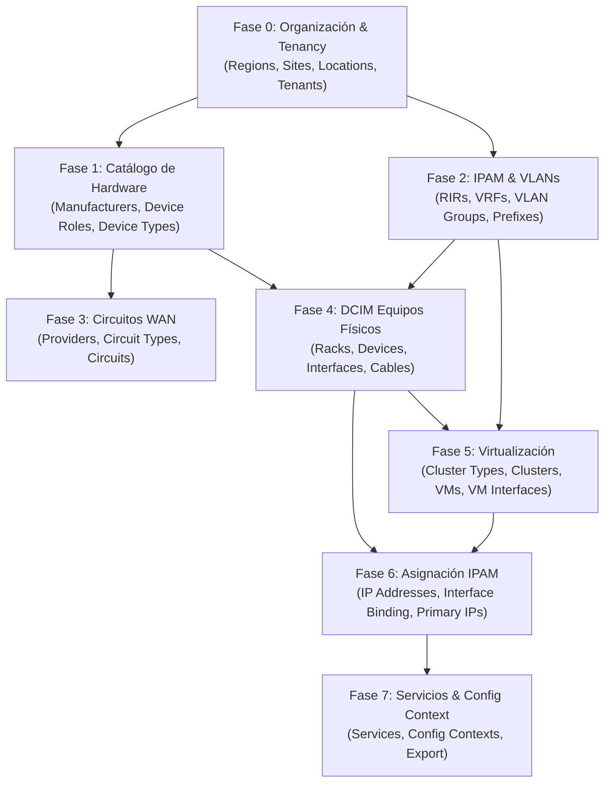

  
GUÍA TÉCNICA Y METODOLOGÍA OPERATIVA

  
INFRA.NETBOX.Procedimiento_Ingesta_Gestion_NetBox

  
Metodología de Modelado, Ingesta Jerárquica y Gestión Integral de Infraestructura en NetBox

<h3 style="color: #4A5568; font-style: italic;">Control de Registro de Cambios</h3>

<table class="doc-table">
  <thead>
    <tr>
      <th style="width: 12%;">Versión</th>
      <th style="width: 15%;">Fecha</th>
      <th style="width: 25%;">Autor / Rol</th>
      <th>Resumen de Cambios</th>
    </tr>
  </thead>
  <tbody>
    <tr>
      <td>v1.0</td>
      <td>2026-08-30</td>
      <td>Administrador de Infraestructura</td>
      <td>Emisión inicial del procedimiento de ingesta por dependencias jerárquicas en NetBox.</td>
    </tr>
  </tbody>
</table>

 

Índice

1. [Principios de Modelado y Relaciones en NetBox](#1-principios-de-modelado-y-relaciones-en-netbox)
2. [Diagrama de Flujo y Jerarquía de Ingesta](#2-diagrama-de-flujo-y-jerarquía-de-ingesta)
3. [Fase 0: Organización, Localización y Tenancy](#3-fase-0-organización-localización-y-tenancy)
4. [Fase 1: Catálogo de Hardware y Definición de Tipos](#4-fase-1-catálogo-de-hardware-y-definición-de-tipos)
5. [Fase 2: Redes y Jerarquía IPAM (VLANs, VRFs y Prefijos)](#5-fase-2-redes-y-jerarquía-ipam-vlans-vrfs-y-prefijos)
6. [Fase 3: Circuitos y Conectividad WAN Externa](#6-fase-3-circuitos-y-conectividad-wan-externa)
7. [Fase 4: Despliegue de Equipamiento Físico y DCIM](#7-fase-4-despliegue-de-equipamiento-físico-y-dcim)
8. [Fase 5: Infraestructura de Cómputo y Virtualización](#8-fase-5-infraestructura-de-cómputo-y-virtualización)
9. [Fase 6: Asignación y Enlace de Direccionamiento IP](#9-fase-6-asignación-y-enlace-de-direccionamiento-ip)
10. [Fase 7: Servicios de Red, Config Contexts y Source of Truth](#10-fase-7-servicios-de-red-config-contexts-y-source-of-truth)
11. [Estrategias de Carga Masiva y Automatización](#11-estrategias-de-carga-masiva-y-automatización)

---

1. Principios de Modelado y Relaciones en NetBox

NetBox funciona como una **Fuente Única de Verdad (Source of Truth - SoT)** con un modelo relacional estricto de integridad referencial. A diferencia de una hoja de cálculo o base de datos plana:
- No es posible instanciar un dispositivo (`Device`) sin un Sitio (`Site`), un Rol (`Device Role`) y un Modelo de Hardware (`Device Type`) previamente registrados.
- No es posible asignar una dirección IP (`IP Address`) a una interfaz sin haber creado previamente el prefijo contenedor (`Prefix`) o la interfaz de destino.
- El catálogo de hardware (`Device Types`) actúa como plantilla reutilizable que define de antemano el número y nomenclatura de interfaces físicas, módulos de fuente y puertos de consola.

  
REGLA FUNDAMENTAL DE INGESTA

  

    La ingesta debe respetar estrictamente el orden de resolución de dependencias de abajo hacia arriba (Bottom-Up): primero la taxonomía y definiciones maestras, después la infraestructura física, posteriormente la virtualización y finalmente el enlace de direccionamiento IP y servicios.
  

---

2. Diagrama de Flujo y Jerarquía de Ingesta

---

3. Fase 0: Organización, Localización y Tenancy

Establece el marco geográfico, administrativo y físico donde residen los recursos.

3.1. Inquilinos y Departamentos (Tenancy)

Si la compañía gestiona múltiples entidades, clientes, departamentos o unidades de negocio:
- **Tenant Groups**: Agrupaciones lógicas de alto nivel (ej: *Departamentos Internos*, *Clientes Cloud*, *Sociedades Filiales*).
- **Tenants**: Entidad propietaria directa de los recursos (ej: *IT Infraestructura*, *Finanzas*, *Empresa_A*).

3.2. Taxonomía Geográfica y Salas Técnicas

<table class="doc-table">
  <thead>
    <tr>
      <th>Elemento NetBox</th>
      <th>Descripción</th>
      <th>Ejemplo</th>
    </tr>
  </thead>
  <tbody>
    <tr>
      <td><code>Regions</code></td>
      <td>Área geográfica o país para agrupar sedes.</td>
      <td><code>Iberia</code>, <code>Latam</code>, <code>Europa Central</code></td>
    </tr>
    <tr>
      <td><code>Site Groups</code></td>
      <td>Categorización funcional de sedes.</td>
      <td><code>Data Centers</code>, <code>Oficinas Corporativas</code>, <code>Plantas Industriales</code></td>
    </tr>
    <tr>
      <td><code>Sites</code></td>
      <td>Sede física principal o centro de datos.</td>
      <td><code>MAD-DC01</code>, <code>BCN-OFFICE</code>, <code>VLC-PLANT</code></td>
    </tr>
    <tr>
      <td><code>Locations</code></td>
      <td>Subdivisiones físicas dentro del Site (edificio, planta, sala técnica).</td>
      <td><code>Edificio B - Planta 2</code>, <code>Sala Servidores Principal</code></td>
    </tr>
    <tr>
      <td><code>Rack Roles</code></td>
      <td>Función operativa de los armarios rack.</td>
      <td><code>Network Core</code>, <code>Compute & Storage</code>, <code>Patching Distribution</code></td>
    </tr>
    <tr>
      <td><code>Racks</code></td>
      <td>Armarios rack físicos con altura en U (unidades).</td>
      <td><code>Rack-01 (42U)</code>, <code>Rack-02 (48U)</code></td>
    </tr>
  </tbody>
</table>

---

4. Fase 1: Catálogo de Hardware y Definición de Tipos

Construye la biblioteca de plantillas reutilizables. Evita tener que crear interfaces manualmente para cada equipo.

4.1. Fabricantes, Plataformas y Roles

- **Manufacturers**: `Cisco`, `Fortinet`, `Dell`, `HPE`, `Palo Alto`, `APC`, `Synology`.
- **Platforms**: Sistemas operativos de red y host para gestión de drivers y playbooks (`FortiOS 7.x`, `Cisco IOS-XE`, `VMware ESXi 8.0`, `Ubuntu 24.04 LTS`).
- **Device Roles**: Funcionalidad lógica asignada con color distintivo:
  - `Firewall / Security Gateway`
  - `Core Switch` / `Distribution Switch` / `Access Switch`
  - `Hypervisor / Physical Server`
  - `Storage Array / SAN`
  - `PDU / UPS`

4.2. Plantillas de Dispositivos (Device Types y Module Types)

- **Device Types**: Modelo específico de hardware (ej: `FortiGate-100F`, `Catalyst 9300-48P`, `PowerEdge R750`).
  - Define interfaces preconfiguradas (`GigabitEthernet1/0/1..48`, `TenGigabitEthernet1/1/1..4`).
  - Define fuentes de alimentación (`PSU1`, `PSU2`) y puertos de consola.
- **Biblioteca Comunitaria**: Importar definiciones directamente desde [netbox-community/devicetype-library](https://github.com/netbox-community/devicetype-library) para modelos estándar.
- **Module Types**: Tarjetas de expansión (linecards, transceivers SPF28, módulos PCIe).

---

5. Fase 2: Redes y Jerarquía IPAM (VLANs, VRFs y Prefijos)

Estructura el mapa lógico de direccionamiento y segmentación de red antes de conectar interfaces.

5.1. VRFs y VLANs

1. **VRFs (Virtual Routing and Forwarding)**:
   - Necesario si existen tablas de enrutamiento aisladas o superposición de IPs (ej: `VRF_CORPORATE`, `VRF_GUEST`, `VRF_MANAGEMENT`).
2. **VLAN Groups**:
   - Ámbitos de VLAN asignados a nivel global o por `Site` (ej: `VLAN-GROUP-MAD-DC01`).
3. **VLANs**:
   - Registro de VLAN IDs (1 a 4094), nombres y estados (ej: `VLAN 10 - MGMT`, `VLAN 20 - DATA`, `VLAN 30 - DMZ`, `VLAN 100 - VOIP`).

5.2. Jerarquía de Prefijos IP (Prefixes)

NetBox anida los prefijos automáticamente por máscara:

<table class="doc-table">
  <thead>
    <tr>
      <th>Nivel Jerárquico</th>
      <th>Prefijo CIDR</th>
      <th>Rol NetBox</th>
      <th>Descripción</th>
    </tr>
  </thead>
  <tbody>
    <tr>
      <td><strong>Supernet Global</strong></td>
      <td><code>10.0.0.0/8</code></td>
      <td>Container</td>
      <td>Espacio privado total de la organización.</td>
    </tr>
    <tr>
      <td><strong>Bloque por Sede</strong></td>
      <td><code>10.100.0.0/16</code></td>
      <td>Container</td>
      <td>Asignado al Site <code>MAD-DC01</code>.</td>
    </tr>
    <tr>
      <td><strong>Subred de Servicio</strong></td>
      <td><code>10.100.10.0/24</code></td>
      <td>Active</td>
      <td>Asociado a <code>VLAN 10 (MGMT)</code> en <code>MAD-DC01</code>.</td>
    </tr>
    <tr>
      <td><strong>Pool / Rango DHCP</strong></td>
      <td><code>10.100.20.100 - 10.100.20.200</code></td>
      <td>IP Range (DHCP)</td>
      <td>Rango de asignación dinámica de clientes.</td>
    </tr>
  </tbody>
</table>

---

6. Fase 3: Circuitos y Conectividad WAN Externa

1. **Providers**: Proveedores de telecomunicaciones (Telefónica, Vodafone, Colt, Lumen).
2. **Circuit Types**: Tipos de servicio (`Dedicated Internet Access (DIA)`, `MPLS WAN`, `Dark Fiber`, `Point-to-Point`).
3. **Circuits**: Código de circuito/identificador de contrato, velocidad comprometida y fecha de activación.
4. **Circuit Terminations**: Extremos de conexión física que se rematan en los puertos WAN de los firewalls o routers perimetrales.

---

7. Fase 4: Despliegue de Equipamiento Físico y DCIM

Instanciación de la infraestructura física en los bastidores.

7.1. Registro de Dispositivos (Devices)

Al crear un equipo en NetBox se seleccionan los componentes de las fases anteriores:
- **Nombre / Hostname**: `SW-MAD-CORE-01`, `FW-MAD-PERIM-01`, `SRV-ESXI-MAD-01`.
- **Asignación Física**: `Site` $\rightarrow$ `Location` $\rightarrow$ `Rack` $\rightarrow$ `Posición U` y `Face` (Frontal/Trasera).
- **Asignación Lógica**: `Device Type`, `Role`, `Platform`, `Status` (Active, Staged, Offline).

7.2. Configuración de Interfaces Físicas

Las interfaces se crean automáticamente desde el `Device Type`. En esta fase se ajusta su configuración L2:
- **Modo 802.1Q**: `Access` (Untagged VLAN asignada) o `Tagged` / `Trunk` (Tagged VLANs permitidas).
- **LAG / LACP**: Agrupación de interfaces físicas en Port-Channels / Bonds (`Bond0`, `Port-Channel1`).

7.3. Conexiones Físicas y Cableado (Cables)

- Enlace punto a punto entre puertos de dispositivos, paneles de parcheo (`Front Ports` / `Rear Ports`) y circuitos de proveedor.

---

8. Fase 5: Infraestructura de Cómputo y Virtualización

Modelado de la capa de hipervisores y máquinas virtuales.

8.1. Clusters y Asignación de Hipervisores

1. **Cluster Types**: `VMware vSphere`, `Proxmox VE`, `Nutanix AHV`, `Hyper-V`, `Kubernetes`.
2. **Clusters**: Instancia de cluster (ej: `CL-MAD-PROD-01`) vinculada a un `Site`.
3. **Asignación de Hosts**: Los `Devices` físicos (servidores ESXi/Proxmox creados en Fase 4) se vinculan como miembros del `Cluster`.

8.2. Máquinas Virtuales (Virtual Machines)

- Registro de instancias de cómputo virtual:
  - Nombre: `VM-MAD-APP-01`, `VM-MAD-DB-01`, `VM-MAD-DC-01`.
  - Recursos asignados: `vCPUs`, `Memoria RAM (MB/GB)`, `Espacio en Disco (GB)`.
  - Rol, Plataforma y Tenant.
- **Interfaces Virtuales (`VM Interfaces`)**:
  - Creación de vNICs asignadas a sus respectivos `VLANs` y `Port Groups`.

---

9. Fase 6: Asignación y Enlace de Direccionamiento IP

Cierre del ciclo IPAM vinculando direcciones de red con interfaces operativas.

1. **Creación de Direcciones IP (`IP Addresses`)**:
   - Formato CIDR obligatorio (ej: `10.100.10.15/24`, `10.100.20.50/24`).
   - Estado: `Active`, `Reserved`, `DHCP`, `SLAAC`.
2. **Asignación a Interfaz (Interface Binding)**:
   - Se asocia la dirección IP a la interfaz física del `Device` o a la interfaz virtual de la `Virtual Machine`.
3. **Definición de IP Primaria (`Primary IPv4 / IPv6`)**:
   - Se marca la IP de administración principal del dispositivo o máquina virtual. Esta IP es utilizada por herramientas de automatización, inventarios dinámicos y sistemas de monitorización.

---

10. Fase 7: Servicios de Red, Config Contexts y Source of Truth

Capas superiores para orquestación e integración con el ecosistema de automatización.

1. **Servicios de Red (`Services`)**:
   - Registro de puertos, protocolos y aplicaciones que escuchan en un equipo o IP:
     - `HTTPS (TCP/443)` en el Firewall perimetral.
     - `SSH (TCP/22)` en Switches y Servidores Linux.
     - `DNS (UDP/53)` y `LDAPS (TCP/636)` en Controladores de Dominio.
2. **Contextos de Configuración (`Config Contexts`)**:
   - Parámetros JSON/YAML contextuales asignados por Región, Sitio, Rol o Plataforma (ej: servidores NTP, Syslog, servidores DNS, cadenas SNMP, configuraciones de usuarios administradores).
   - Consumidos directamente por playbooks de Ansible, Terraform o scripts de pipelines CI/CD.

---

11. Estrategias de Carga Masiva y Automatización

Para entornos medianos y grandes, no se debe realizar la carga manual objeto por objeto desde la interfaz web.

<table class="doc-table">
  <thead>
    <tr>
      <th>Mecanismo</th>
      <th>Herramientas</th>
      <th>Objetos recomendados para ingesta</th>
    </tr>
  </thead>
  <tbody>
    <tr>
      <td><strong>Importación Comunitaria</strong></td>
      <td>Git / Submódulo DeviceType</td>
      <td>Device Types, Module Types, Front/Rear Ports.</td>
    </tr>
    <tr>
      <td><strong>Carga Masiva CSV / YAML</strong></td>
      <td>NetBox Built-in Bulk Import</td>
      <td>Sites, Locations, Racks, VLANs, Prefijos IP iniciales.</td>
    </tr>
    <tr>
      <td><strong>Sincronización de Virtualización</strong></td>
      <td>Python (<code>pyVmomi</code>, <code>proxmoxer</code>, <code>pynetbox</code>)</td>
      <td>Clusters, Hosts, VMs, vCPUs, RAM, vNICs e IPs asignadas.</td>
    </tr>
    <tr>
      <td><strong>Descubrimiento de Red</strong></td>
      <td>Ansible, NAPALM, Nornir, SNMP/LLDP</td>
      <td>Topología física, números de serie, tablas ARP e interfaces.</td>
    </tr>
    <tr>
      <td><strong>Control Programático MCP</strong></td>
      <td><code>netbox-mcp</code></td>
      <td>Consultas, altas puntuales, auditorías y conciliaciones continuas.</td>
    </tr>
  </tbody>
</table>
